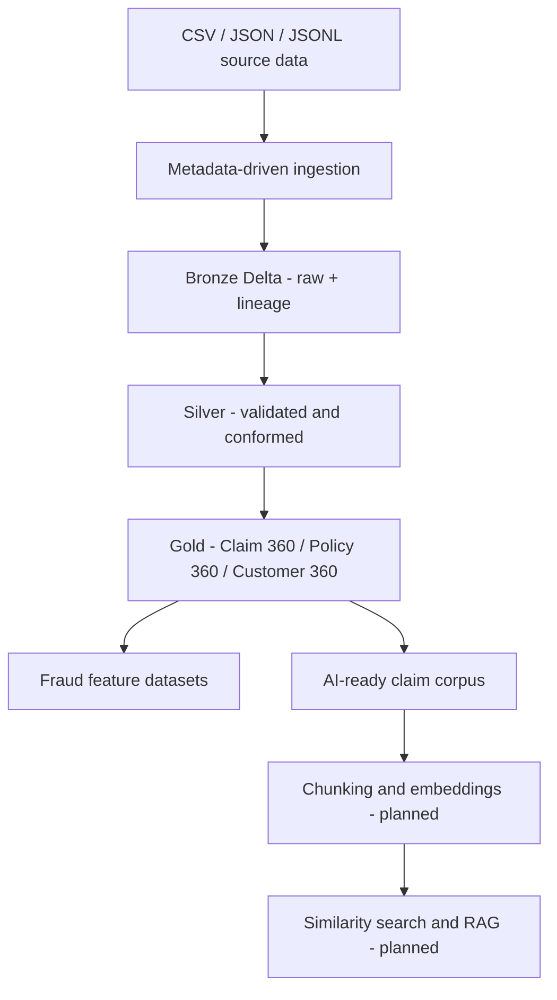

# InsureAI Lakehouse

An AI-ready insurance data engineering platform built with PySpark and Delta Lake concepts. It uses **synthetic Property & Casualty (P&C) insurance data only** to demonstrate reliable ingestion, medallion architecture, data quality, incremental processing, curated data products, and downstream AI preparation.

> **Status:** Milestone 1 scaffold and first reusable ingestion primitives. Databricks execution and runtime compatibility are not yet validated.

## Outcomes

- Metadata-driven ingestion of insurance entities.
- Bronze / Silver / Gold medallion layers.
- Source lineage, run metadata, schema checks, and data quality results.
- A foundation for incremental loads, CDC, and SCD Type 2.
- Gold datasets for claims, policies, customers, and fraud features.
- AI preparation for claim summarisation, similar-claim retrieval, and RAG.

## Domain model

| Entity | Description |
|---|---|
| customers | Synthetic policyholder profiles |
| policies | P&C policies, coverage dates, premiums, status |
| claims | Reported loss events and claim lifecycle |
| claim_transactions | Payments and reserve movements |
| claim_notes | Synthetic adjuster notes |
| claim_documents | Synthetic document metadata and extracted text |

## Architecture



## Repository map

- `configs/`: source and table configuration
- `docs/`: architecture and engineering decisions
- `src/insureai/`: reusable Python and PySpark components
- `notebooks/`: Databricks entry points (next milestone)
- `tests/`: unit tests
- `data/sample/`: tiny synthetic fixtures only

## Local setup

Python 3.10+ is required. PySpark integration requires a compatible Java runtime.

```bash
python -m venv .venv
# Windows: .venv\\Scripts\\activate
# macOS/Linux: source .venv/bin/activate
pip install -e ".[dev]"
pytest
```

## Delivery plan

- [x] Architecture and initial repository scaffold
- [x] Source configuration contract and validation
- [x] Bronze batch ingestion primitive with audit columns
- [x] Basic data quality checks
- [ ] Synthetic source generator
- [ ] Silver conformance, deduplication, and SCD Type 2
- [ ] Incremental ingestion / CDC
- [ ] Gold insurance data products
- [ ] Fraud feature engineering
- [ ] RAG document preparation and evaluation
- [ ] Databricks Workflows, observability, and deployment guide

Azure storage and production deployment are future extensions. The initial project is designed to be developed locally and adapted to the user's available Databricks workspace without assuming paid Azure resources.

## Responsible use

All records and narratives are synthetic. Fraud indicators are analytical signals, not proof of wrongdoing or a basis for automated claim denial. Consequential decisions require appropriate human review.

## License

MIT.
